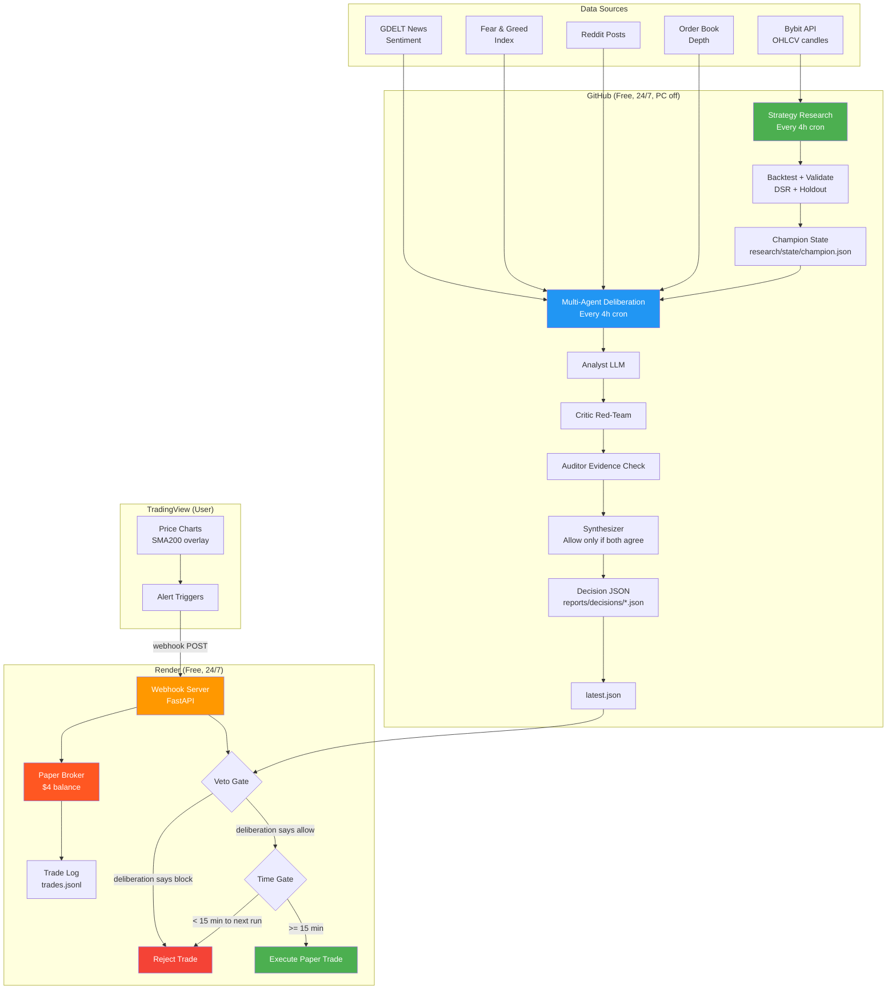

# System Architecture



## How it works (plain English)

### The 4-hour cycle
```
00:00 UTC → GitHub fetches fresh Bybit candles
         → Backtests all strategies on train + holdout
         → Multi-agent deliberation (analyst → critic → auditor → synthesizer)
         → Writes decision JSON (allow/block per pair)
         → Commits to repo
00:01-03:44 → Webhook server reads latest decision
           → If TradingView alert arrives: check veto + time gate
           → If both pass: execute paper trade
03:45-03:59 → Time gate blocks new entries (preparing for next run)
04:00 UTC → Cycle repeats with fresh data
```

### What "bearish mode" means
- Price is below SMA200 (200-period moving average)
- EMA50 and EMA200 slopes are negative (falling)
- The multi-agent system votes: BLOCK all entries
- This is correct — the strategy is "hold while above SMA200, cash otherwise"
- No trades = capital preserved = correct behavior in a downtrend

### When will it trade?
When ALL of these are true:
1. Price crosses above SMA200 (bullish regime)
2. Analyst agent says "allow"
3. Critic agent finds no flaws
4. Auditor confirms evidence
5. Synthesizer merges all votes → "allow"
6. Risk agent size_cap > 0 (drawdown < 10%, BTC above EMA200)
7. Time gate: >= 15 min to next 4h run
8. TradingView alert fires with matching symbol

### Assets monitored
- BTC/USDT, ETH/USDT, SOL/USDT, BNB/USDT, XRP/USDT
- Selected because SMA200 trend-following showed positive edge on all 5
- Research harness tests all candidates every run and can promote new assets

### Real money path (future)
1. Now → 30-60 days: paper trade $4, collect outcome data
2. After 60 days: review agent accuracy + PnL
3. If positive: scale to $50-100 paper
4. After 90 days profitable: consider live with small real capital
5. Never skip paper trading — the webhook server is already set up for this

### What makes it "professional"
- Systematic rules tested on 4+ years of real data with real costs (0.1% fee + 0.02% slippage)
- Multi-agent red-teaming (critic tries to falsify every decision)
- Fail-closed safety (if uncertain, block)
- Evidence citations (every claim must cite numbers)
- Paper trading first ($4, no real money)
- Outcome tracking (did the decision match reality?)
- Deflated Sharpe Ratio correction for multiple testing
- Rolling holdout (most recent 180 days, never seen during search)

### Infrastructure (all free)
- GitHub Actions: research + deliberation (24/7, PC off)
- Render.com: webhook server + paper broker (24/7, PC off)
- Bybit: market data (free public API)
- TradingView: charts + alerts (free tier, alerts limited)
PY
echo "created"